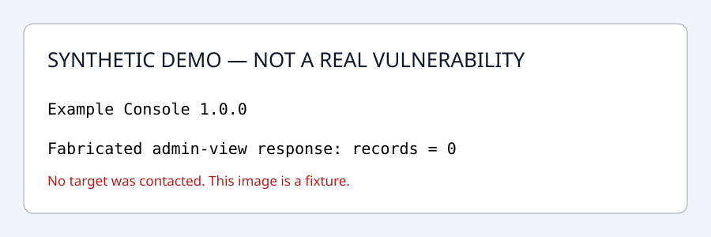

# Hunting Workflow

**把已有资产和研究证据整理成可审阅、可追溯的漏洞报送草稿。**

面向个人研究者和协作者的轻量工作流：Python 3.9+、零第三方运行依赖、离线执行。
首版包含 **资产整理** 和 **CNNVD 材料准备** 两个模块，提供完整与故意缺项的合成案例。

[English](README.en.md) · [方法论](docs/methodology.md) · [CNNVD 工作流](docs/cnnvd.md) · [数据模型](docs/data-model.md) · [来源与时效性](docs/sources.md)

## 三条命令跑通

```sh
git clone https://github.com/MosEcho/hunting-workflow.git
cd hunting-workflow
python3 run.py demo --output out/demo
```

Windows 上如果没有 `python3`，使用 `python`。下载源码 ZIP 并解压后也可直接执行最后一条命令。
无需账号、API Key、LLM、Docker、真实资产或 `pip install`。

生成后，先读 `out/demo/START-HERE.md`，再用浏览器打开 `out/demo/complete/report.html`。

| 产物 | 看什么 |
|---|---|
| `assets/review.md` | 6 条输入整理为 4 个服务，合并 2 条重复记录；已验证受影响数量保持未知 |
| `complete/report.md`、`report.html` | 完整的虚构研究报告、验证记录与证据原文 |
| `complete/form-fields.md`、`form-fields.json` | CNNVD 字段草稿，供人工对照当前页面 |
| `complete/checklist.md` | 示例材料结构完整；合成标记阻止真实报送 |
| `missing/checklist.md` | 缺版本、证据、查重等事项及下一步 |
| `complete-review.zip` | 实体附件与 SHA-256 清单，可脱离源码目录阅读 |



> 所有示例身份、产品、请求响应、截图、检索与人工复核记录均为合成夹具。示例没有联系任何目标，不代表真实漏洞。

## 两条工作流

```text
已有资产 CSV / JSON / TXT
  → URL、端口和主机归一化
  → 服务去重、保留出处与产品/组织声明
  → 资产台账 + 统计局限 + 拒绝行说明

结构化研究记录 + 本地证据
  → 结构、证据哈希和引用校验
  → 实测/静态/未验证断言与缺项检查
  → CNNVD 字段草稿 + 报告 + 审阅清单 + 实体 ZIP
```

通用方法遵循：确认目标与范围 → 资产/产品归属 → 候选分析 → 原创性检索与比较 → 最小验证 → 证据审阅 → 材料准备 → 修订跟踪。
本工具负责已收集资料的整理与检查，研究判断由人完成。

## 处理自己的资料

资产导入：

```sh
python3 run.py assets normalize examples/assets.csv --output out/assets
```

案例检查、生成和导出：

```sh
python3 run.py case check examples/complete-case/case.json --json
python3 run.py case build examples/complete-case/case.json --output out/case
python3 run.py case export out/case --output out/case-review.zip
```

第一条示例检查返回退出码 **2**，因为演示数据禁止真实报送；这是预期结果。
`case build` 返回 0 仅表示草稿生成成功，材料状态写在 `readiness.json`。
完整命令、状态和输入格式见 [CLI 文档](docs/cli.md)。使用 [空案例模板](templates/case.json) 建立自己的私有记录。
输出目录必须是新目录，避免覆盖已有证据和版本。

如需安装命令行入口，可选执行 `python3 -m pip install .`，然后使用 `hunting-workflow`；安装阶段可能需要获取构建工具，运行阶段没有第三方依赖。

## 判定边界

- 测绘命中、版本可能受影响、实际验证受影响分别记录；主机数不直接换算为单位数或受影响实例数。
- 文件存在、SHA-256 和引用一致，只能证明材料结构与字节可核对，不能自动判断漏洞成立、授权有效或原创性。
- CNNVD 配置是待人工核对的草稿映射；固定案例数、注册资金、评级和发证条件不作为程序硬规则。
- 工具不会执行扫描、验证载荷、登录平台或提交漏洞，也不会根据漏洞类型自动决定最终等级。
- `ready_for_manual_submission_review` 仅表示准备进入人工审阅，平台受理、评级与证书状态始终另行判断。

## 仓库布局

```text
hunting_workflow/          CLI、资产整理、证据检查与材料生成
  resources/schemas/       JSON Schema 数据契约
  resources/profiles/      带来源与局限的平台草稿配置
examples/                 完整/缺项的合成案例和资产样本
templates/                空案例与审查/进度模板
docs/                     方法、输入契约、CNNVD 实务与误区
tests/                    边界、反例、离线演示和发布检查
tools/                    文档检查、发布审计、源码包导出
.github/                  CI 与协作模板
```

## 验证与贡献

```sh
python3 -m unittest discover -s tests -v
python3 tools/check_docs.py
python3 tools/audit_public.py
```

CI 覆盖 Linux、macOS、Windows，以及多种 Python 版本。测试包含禁止网络/DNS 时跑通演示、证据篡改、越界路径、合成标记、缺项和实体 ZIP 校验。

[贡献指南](CONTRIBUTING.md) · [发布范围](docs/publication.md) · [安全反馈](SECURITY.md) · [版本记录](CHANGELOG.md) · [MIT License](LICENSE)
